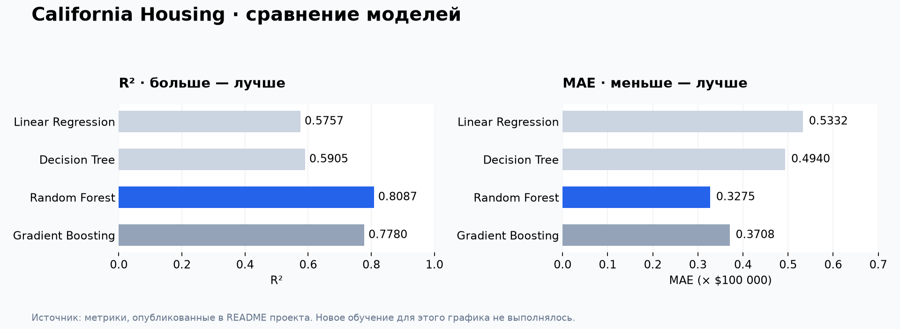

# Housing Price Prediction

**Стек:** Python · pandas · scikit-learn · matplotlib



*График построен по метрикам из README проекта; новое обучение для него не выполнялось.*

Учебный ML-проект по предсказанию цен на недвижимость с использованием набора данных California Housing.

## Описание

Проект включает полный цикл работы с данными:

- **Разведочный анализ данных (EDA)** — исследование распределений, корреляций и выбросов
- **Предобработка** — масштабирование признаков, обработка пропусков
- **Моделирование** — обучение и сравнение нескольких моделей (Linear Regression, Decision Tree, Random Forest, Gradient Boosting)
- **Оценка качества** — MAE, RMSE, R² на тестовой выборке
- **Визуализация результатов** — графики предсказаний, важности признаков, остатков

## Стек технологий

- Python 3.11+
- pandas, NumPy — работа с данными
- scikit-learn — машинное обучение
- matplotlib, seaborn — визуализация

## Запуск

```bash
pip install -r requirements.txt
jupyter notebook
```

Откройте `housing_price_prediction.ipynb` и запустите ячейки последовательно.

## Результаты

| Модель | MAE | RMSE | R² |
|---|---|---|---|
| Linear Regression | 0.5332 | 0.7460 | 0.5757 |
| Decision Tree | 0.4940 | 0.7330 | 0.5905 |
| **Random Forest** | **0.3275** | **0.5009** | **0.8087** |
| Gradient Boosting | 0.3708 | 0.5396 | 0.7780 |

Лучший результат показала модель **Random Forest** с R² = 0.81.

## Структура проекта

```
housing-price-prediction/
├── housing_price_prediction.ipynb   # Основной ноутбук
├── requirements.txt                 # Зависимости
└── README.md                        # Описание проекта
```

## Автор

Артем Мастеров — студент ИТМО, направление «Нейротехнологии и искусственный интеллект»
